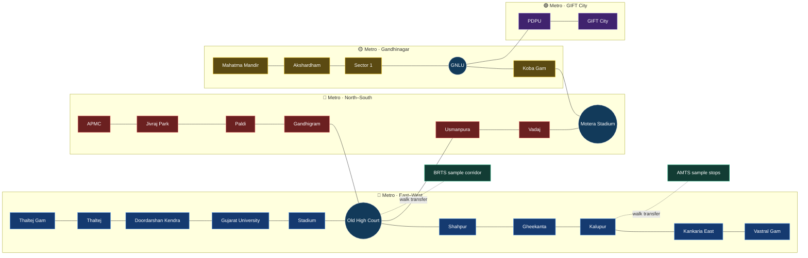

# 🚌 YatraOne — Ahmedabad Transit, Connected

> **One journey. Three networks.** Explore Ahmedabad's Metro, Janmarg BRTS, and AMTS connections in one interactive journey planner.

<p align="center">
  <strong>🚆 Metro</strong> &nbsp; · &nbsp;
  <strong>🚌 BRTS</strong> &nbsp; · &nbsp;
  <strong>🚍 AMTS</strong> &nbsp; · &nbsp;
  <strong>🧭 Multimodal routing</strong>
</p>

<p align="center">
  
  
  
  
</p>

YatraOne turns separate transit networks into one place to explore routes, transfers, and journey options. It combines an interactive schematic map with a browser-based route planner and keeps estimated data clearly labeled.

## ✨ What you can do

- Find connections between stops in the bundled Ahmedabad network.
- Compare **Fastest**, **Cheapest**, and **Balanced** sample itineraries, ranked by each option's objective score.
- Explore the network map with zoom, pan, mode filters, and clickable stop details.
- Follow long selected route legs with mode-colored, full-length map highlights.
- Check a stop in Google Maps from its detail panel.
- Read bilingual English and Gujarati stop labels.
- Switch the main planner, itinerary steps, fare panel, stop details, and AI assistant between English and Gujarati.
- Follow transfer guidance and a step-by-step journey timeline.
- Open official Metro, BRTS, and AMTS fare pages from the estimate panel.
- Ask the AI trip assistant to explain the selected itinerary and look up nearby bus stops with Google Maps grounding.
- Try the prototype offline after the app has loaded.

## 🤖 AI trip assistant (optional)

The trip assistant runs through a local Vite server endpoint. It receives the selected trip's stop names, modes, and clearly labeled prototype estimates; Google Maps Grounding can provide linked stop and place references. The Gemini key stays server-side and is not included in the browser bundle.

The header language control switches between English and Gujarati. Station names use Gujarati dataset labels where available; operator and corridor names remain in their commonly used forms.

To enable it, create `.env.local` in the project root (this filename is ignored by Git) and add:

```dotenv
GEMINI_API_KEY=your-gemini-api-key
# Optional: override the model used by the assistant
# GEMINI_MODEL=gemini-3.5-flash
```

Restart `npm run dev` after saving the file. The feature needs an internet connection and a Gemini API key with Google Maps Grounding access. Google may apply usage limits or charges depending on the account and current plan. Answers are AI-generated; verify transit service, fares, and schedules with the operators. When Maps grounding sources are returned, YatraOne displays their title, link, and Google Maps attribution beside the answer.

## 🗺️ A network view

The planner treats each stop and travel mode as part of a graph. Solid colored paths show the referenced Metro sequences; bus corridors are currently simplified prototype coverage.



<sub>Diagram is a simplified route illustration. It omits many stations for readability. It does not claim geographic scale or full live service coverage.</sub>

## 🧠 How route ranking works

YatraOne uses **transfer-aware Dijkstra search** over stop-and-mode states. Search labels also track transfers used, so a route with fewer transfers can remain a candidate even if another path reaches the same stop at lower cost.

| Ranking | What it prioritizes |
| --- | --- |
| **Fastest** | Ride time, estimated wait, walking, and transfer time |
| **Cheapest** | Bundled sample fares, with time used as a small tie-breaker |
| **Balanced** | Normalized time and sample fare, plus transfer and walking penalties |

The balanced score is additive, so the shortest-path algorithm can compare paths consistently. All fare-based ranking still depends on prototype fare values until official fare data is integrated.

## 🚀 Run it locally

**Requirements:** Node.js and npm.

```bash
npm install
npm run dev
```

Open the local URL shown by Vite (usually [http://localhost:5173](http://localhost:5173)).

```bash
npm run build
```

## 🧰 Built with

- **React 19** — interactive app and route/map components
- **Vite 8** — local development and production builds
- **JavaScript + JSON** — client-side graph search and bundled network data
- **Lucide React** — interface icons
- **SVG** — interactive schematic transit map

## 💸 Fare and data transparency

**Are fares real? No.** The current fare numbers are illustrative values in the prototype dataset. The previously invented ₹5 multimodal discount is disabled. The estimate panel links to the operators' live fare tools:

- [GMRC Metro route and fare planner](https://www.gujaratmetrorail.com/ahmedabad/route-and-fares/)
- [Ahmedabad BRTS fare checker](https://www.ahmedabadbrts.org/en/information/fare-chart/)
- [AMTS ticketing and fare page](https://www.amts.co.in/ticketing/)

Google Maps links open a search for a selected stop; they do not import Google route, bus number, or arrival data into YatraOne. The repository contains no Google Maps Platform API key.

### Current data status

| Network | What is represented | Limitation |
| --- | --- | --- |
| Metro | Station sequences and graph links based on the referenced station directory | Coordinates, travel times, and fare edges are not fully validated |
| BRTS | A few sample corridors and stops | Not a complete stop inventory or route feed |
| AMTS | Prototype stops and links | Not a current, complete route-by-route feed |

The app is a **hackathon prototype**, not a live passenger information service. Verify fares, service status, and route details with operators before travel. Bundled records are marked `prototype_unverified` where the source field is present.

### References

- [GMRC Ahmedabad Metro](https://www.gujaratmetrorail.com/ahmedabad/route-and-fares/)
- [Ahmedabad Janmarg / BRTS](https://www.ahmedabadbrts.org/en/plan/)
- [AMTS](https://www.amts.co.in/)
- [Google Routes API — transit routes](https://developers.google.com/maps/documentation/routes/transit-route)
- [Google Transit stop and station guidance](https://support.google.com/transitpartners/answer/6377423?hl=en)

## 🛣️ Roadmap

Future feature requests and implementation plans belong here so the README stays the project’s shared roadmap.

- [ ] Replace prototype coordinates with validated station/stand coordinates and real route shapes.
- [ ] Import current BRTS and AMTS route numbers and ordered stops in both directions.
- [ ] Add verified bus stand details: route numbers, nearby landmarks, platform/bay, accessibility, and operator links.
- [ ] Add official fare lookups or a dated, verified fare table for each network.
- [ ] Add service calendars, timetables, live arrivals, and clear data freshness labels.
- [ ] Verify walking transfers between Metro and bus stands.
- [ ] Evaluate a Google Maps Platform integration with a restricted key, billing and attribution requirements documented.
- [ ] Add a geographic map mode alongside the schematic network.

## 🧱 Project structure

```text
src/
├── components/   # Map, stop details, journey cards, ticket estimate, timeline
├── data/         # Stops, lines, sample connections, transfers, configuration
├── engine/       # Graph search, fare estimate, startup validation
└── security/     # Input sanitization and search rate limiting
```
<p align="center"><strong>YatraOne — Make the next connection easier to see.</strong></p>

