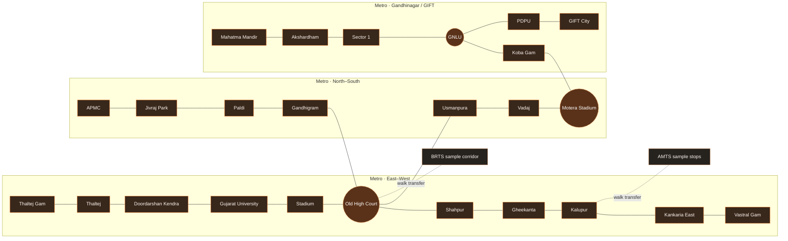

<div align="center">

# YatraOne
### Ahmedabad transit, connected.

**One journey. Three networks.** Plan across Metro, Janmarg BRTS, and AMTS in one interactive city transit experience.


<p>
  
  
  
  
</p>

[Explore the app](#run-locally) · [See how routing works](#route-finding) · [Read data notes](#fares-and-data-honesty) · [View the roadmap](#roadmap)

</div>

---

## At a glance

| | |
| --- | --- |
| **Purpose** | Plan and explore multimodal trips across Ahmedabad transit networks |
| **Modes** | Ahmedabad Metro, Janmarg BRTS, and AMTS |
| **Languages** | English and Gujarati |
| **Route options** | Fastest, Cheapest, and Balanced |
| **App** | React 19 + Vite 8 |
| **Data status** | Local prototype network; fares and bus coverage are not live |

YatraOne brings transit routes, transfer guidance, a schematic network map, and journey estimates together. It is designed as a clear, visual prototype for exploring how Ahmedabad's separate networks can connect.

## A transit experience built for the city

- **Plan across modes.** Choose stops and compare Fastest, Cheapest, and Balanced sample journeys.
- **Explore the network.** Use the high-contrast dark map canvas, clear mode filters and route legend; zoom, pan, and open stop details in either app theme.
- **Follow the route.** See selected legs highlighted by transit mode, with step-by-step transfer guidance.
- **Use your language.** Switch planner details, stop names, journey steps, fares, and assistant between English and Gujarati where translations are available.
- **See the city in motion.** The landing page uses a muted, looping 10-second, 720p video at [`public/videos/gemini_generated_video_429b205b.mp4`](public/videos/gemini_generated_video_429b205b.mp4), with a still poster for reduced-motion settings.
- **Keep the controls legible.** A transparent, blurred glass header and boxed navigation sit over the video with warm orange highlights.
- **Check the source.** Stop details link to Google Maps searches; fare estimates link to operator fare pages.
- **Try it offline.** The core planner and bundled data work locally after the app loads.

## Route finding

YatraOne models stops and transit modes as a graph. It uses **transfer-aware Dijkstra search** over stop-and-mode states. Search labels track transfers used so that a promising route with fewer changes can remain a candidate alongside a shorter path.

| Option | What it favors |
| --- | --- |
| **Fastest** | Ride time plus estimated waiting, walking, and transfer time |
| **Cheapest** | Bundled sample fares, with time as a small tie-breaker |
| **Balanced** | Normalized time and sample fare, with transfer and walking penalties |

The Balanced score is additive, so the shortest-path search can compare partial paths consistently. Fare-based rankings depend on prototype fare values until verified fare data is integrated.

### Network illustration

The map combines referenced Metro station sequences with simplified prototype bus corridors. This diagram is intentionally schematic: it omits stops for readability and does not represent geographic scale or complete live coverage.



## Run locally

**Requirements:** Node.js and npm.

```bash
npm install
npm run dev
```

Open the local URL printed by Vite (usually [http://localhost:5173](http://localhost:5173)). Create a production build with:

```bash
npm run build
```

## Optional: AI trip assistant

The assistant runs through a local Vite server endpoint. It receives the selected trip's stop names, modes, and clearly labeled prototype estimates. When Google Maps Grounding is enabled, answers can include linked stop and place references. The Gemini key stays on the server and is not included in the browser bundle.

To enable it, create `.env.local` in the project root (Git ignores this file):

```dotenv
GEMINI_API_KEY=your-gemini-api-key
# Optional: choose a supported model
# GEMINI_MODEL=gemini-3.5-flash
```

Restart the development server after saving the file. The assistant needs an internet connection and a Gemini API key with Google Maps Grounding access. Google may apply usage limits or charges based on the account and current plan. Answers are AI-generated; verify transit service, fares, and schedules with the operators. When grounding sources are returned, YatraOne shows their titles, links, and Google Maps attribution.

## Fares and data honesty

> **Are the fares real? No.** Current fare values are illustrative prototype data. The previously invented ₹5 multimodal discount is disabled. The estimate panel links to operator fare tools for checking current prices.

- [GMRC Metro route and fare planner](https://www.gujaratmetrorail.com/ahmedabad/route-and-fares/)
- [Ahmedabad BRTS fare checker](https://www.ahmedabadbrts.org/en/information/fare-chart/)
- [AMTS ticketing and fare page](https://www.amts.co.in/ticketing/)

Google Maps links search for the selected stop. YatraOne does **not** import live Google route, bus number, timetable, or arrival data; the repository contains no Google Maps Platform API key.

| Network | Included in this prototype | Current limitation |
| --- | --- | --- |
| **Metro** | Station sequences and graph links based on the referenced station directory | Coordinates, travel times, and fare edges need validation |
| **BRTS** | A small set of sample corridors and stops | Not a complete stop inventory or route feed |
| **AMTS** | Prototype stops and links | Not a current, complete route-by-route feed |

YatraOne is a **hackathon prototype**, not a live passenger information service. Verify fares, service status, and route details with transit operators before travel. Bundled records are marked `prototype_unverified` where the source field is present.

### References

- [GMRC Ahmedabad Metro](https://www.gujaratmetrorail.com/ahmedabad/route-and-fares/)
- [Ahmedabad Janmarg / BRTS](https://www.ahmedabadbrts.org/en/plan/)
- [AMTS](https://www.amts.co.in/)
- [Google Routes API: transit routes](https://developers.google.com/maps/documentation/routes/transit-route)
- [Google Transit stop and station guidance](https://support.google.com/transitpartners/answer/6377423?hl=en)

## Roadmap

Keep future feature requests and implementation plans here so the README remains the shared project roadmap.

- [ ] Replace prototype coordinates with validated station and stand coordinates and real route shapes.
- [ ] Import current BRTS and AMTS route numbers and ordered stops in both directions.
- [ ] Add verified bus stand details: route numbers, nearby landmarks, platform or bay, accessibility, and operator links.
- [ ] Add official fare lookups or a dated, verified fare table for each network.
- [ ] Add service calendars, timetables, live arrivals, and clear data freshness labels.
- [ ] Verify walking transfers between Metro stations and bus stands.
- [ ] Evaluate Google Maps Platform integration, including restricted keys, billing, and attribution.
- [ ] Add a geographic map mode alongside the schematic network.

## Project structure

```text
src/
├── components/   # Map, stop details, journey cards, ticket estimate, timeline
├── data/         # Stops, lines, sample connections, transfers, configuration
├── engine/       # Graph search, fare estimate, startup validation
└── security/     # Input sanitization and search rate limiting
public/
├── images/       # Hero poster artwork
└── videos/       # Looping landing-page video
```

---

<div align="center">

**YatraOne** · Make the next connection easier to see.

</div>
