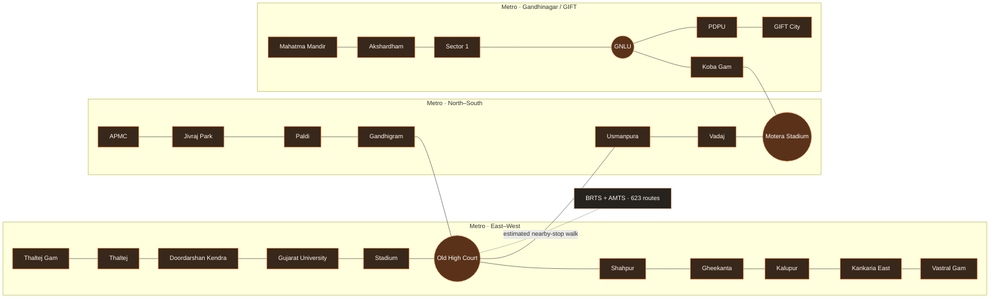

<div align="center">

# YatraOne
### Ahmedabad transit, connected.

**One journey. Three networks.** Plan across Metro, Janmarg BRTS, and AMTS in one interactive city transit experience.


<p>
  
  
  
  
</p>

[Explore the app](#run-locally) · [See how routing works](#route-finding) · [Read data notes](#fares-and-data-honesty) · [View the roadmap](#roadmap)

</div>

---

## At a glance

| | |
| --- | --- |
| **Purpose** | Plan and explore multimodal trips across Ahmedabad transit networks |
| **Modes** | Ahmedabad Metro, Janmarg BRTS, and AMTS |
| **Languages** | English and Gujarati |
| **Route options** | Fastest, Cheapest, and Balanced |
| **App** | React 19 + Vite 8 |
| **Data status** | 623 bus routes and 3,129 stops from a dated community GTFS feed; no live arrivals |
| **Fare status** | Prototype Metro fares, community-feed BRTS fares, and clearly marked distance-based bus predictions |

YatraOne brings bus route numbers, transfer guidance, a geographic network map, and journey estimates together. It is a local journey-planning prototype for exploring connections across Ahmedabad's transit networks.

## A transit experience built for the city

- **Plan across modes.** Search more than 3,100 bus stops and Metro stations, then compare Fastest, Lowest Known Fare, and Balanced routes.
- **Explore the network.** See 623 bus routes drawn from feed stop sequences, with mode filters, zoom, pan, stop details, and active-route highlighting.
- **Follow the route.** See selected legs highlighted by transit mode, with step-by-step transfer guidance.
- **Use your language.** Switch planner details, stop names, journey steps, fares, and assistant between English and Gujarati where translations are available.
- **See the city in motion.** The landing page uses a muted, looping 10-second, 720p video at [`public/videos/gemini_generated_video_429b205b.mp4`](public/videos/gemini_generated_video_429b205b.mp4), with a still poster for reduced-motion settings.
- **Keep the controls legible.** A transparent, blurred glass header and boxed navigation sit over the video with warm orange highlights.
- **Check the source.** Stop details link to Google Maps searches; fare estimates link to operator fare pages.
- **Try it offline.** The core planner and bundled data work locally after the app loads.

## Route finding

YatraOne models stops and transit modes as a graph. It uses **transfer-aware Dijkstra search** over stop-and-mode states. Search labels track transfers used so that a promising route with fewer changes can remain a candidate alongside a shorter path.

| Option | What it favors |
| --- | --- |
| **Fastest** | Ride time plus estimated waiting, walking, and transfer time |
| **Lowest Estimated Fare** | Routes ranked by known fares plus labeled distance-based bus fare predictions |
| **Balanced** | Estimated time, transfers, and known fares plus distance-based predictions where needed |

Search uses a binary min-heap for its open set, so it can prioritize the next best partial route without sorting the full queue after every step. The lowest-fare option compares known fares and predicted bus fares; predictions never appear as verified operator prices.

The planner runs in a dedicated browser Web Worker. The expanded bus graph contains more than 40,000 directed ride edges, and route searches can take several seconds; keeping that work off the page thread prevents map interactions and controls from freezing while a route is calculated.

For faster startup, trip results, ticket details, the operator panel, and data-source dialog load only when needed. Transit corridor geometry is built once, routes are simplified within two SVG viewBox units, and the memoized network layer does not rebuild hundreds of SVG routes during map hover or zoom. Map pan and zoom update the SVG transform directly, and stop hover names use a lightweight tooltip instead of rerendering the stop layer.

**Data and fare note:** Bus routes and ordered stop sequences come from a static community GTFS compilation. Bus segment times use scheduled stop-to-stop times from that feed; the app does not yet plan around the current clock, service calendar, or live departure. Mapped BRTS adult fare-zone pairs use the feed's fare products. When a bus fare is missing, YatraOne predicts it from straight-line stop distance multiplied by a 1.35 road-detour factor and a simple per-kilometre rate; it is a rough planning estimate, not an operator fare. Metro times and sample edge fares remain prototype values. Metro-to-bus walks are straight-line proximity estimates, not verified pedestrian paths or station entrances.

### Network illustration

The diagram below is a compact Metro overview. The interactive map uses coordinates from the imported bus feed, overlays the locally clipped Sabarmati River geometry from OpenStreetMap relation [7717294](https://www.openstreetmap.org/relation/7717294), highlights active journey stops, and hides routine stop labels until hover or zoom. OpenStreetMap attribution is shown on the map.



## Run locally

**Requirements:** Node.js and npm.

```bash
npm install
npm run dev
```

Open the local URL printed by Vite (usually [http://localhost:5173](http://localhost:5173)). Create a production build with:

```bash
npm run build
```

## Optional: AI trip assistant

The assistant runs through a local Vite server endpoint. It receives the selected trip's stop names, modes, and clearly labeled prototype estimates. When Google Maps Grounding is enabled, answers can include linked stop and place references. The Gemini key stays on the server and is not included in the browser bundle.

To enable it, create `.env.local` in the project root (Git ignores this file):

```dotenv
GEMINI_API_KEY=your-gemini-api-key
# Optional: choose a supported model
# GEMINI_MODEL=gemini-3.5-flash
```

Restart the development server after saving the file. The assistant needs an internet connection and a Gemini API key with Google Maps Grounding access. Google may apply usage limits or charges based on the account and current plan. Answers are AI-generated; verify transit service, fares, and schedules with the operators. When grounding sources are returned, YatraOne shows their titles, links, and Google Maps attribution.

## Fares and data honesty

> **Are the fares real? Not as an operator-confirmed trip quote.** Metro fares remain illustrative. Mapped BRTS zone pairs use adult fares from the community feed. For missing BRTS fares and AMTS, the app shows a predicted amount based on straight-line distance and a road-detour factor. Treat predictions as rough estimates and confirm prices with the [Janmarg fare checker](https://www.ahmedabadbrts.org/information/fare-chart/) or [AMTS ticketing](https://www.amts.co.in/ticketing/).

- [GMRC Metro route and fare planner](https://www.gujaratmetrorail.com/ahmedabad/route-and-fares/)
- [Ahmedabad BRTS fare checker](https://www.ahmedabadbrts.org/en/information/fare-chart/)
- [AMTS ticketing and fare page](https://www.amts.co.in/ticketing/)

Google Maps links search for the selected stop. YatraOne does **not** import live Google route, bus number, timetable, or arrival data; the repository contains no Google Maps Platform API key.

| Network | Included in this prototype | Current limitation |
| --- | --- | --- |
| **Metro** | Prototype station graph with route and station naming based on GMRC material | Coordinates, travel times, and sample fare edges need validation |
| **BRTS / AJL** | 149 routes, ordered stop patterns, coordinates, scheduled segment times, and adult fare-zone lookup where mapped | Community compilation, not live or operator-verified; fare estimate may be unavailable for unmapped stops |
| **AMTS** | 474 routes, ordered stop patterns, coordinates, scheduled segment times, and distance-based fare predictions | Community compilation, not live; predictions are not operator quotes |

YatraOne is a **hackathon prototype**, not a live passenger information service. Verify fares, service status, and route details with transit operators before travel. The bus feed lists validity from 2026-09-30 through 2027-03-29 and was imported on 2026-10-11. Its source repository says the GTFS was compiled from AMTS and Ahmedabad Janmarg Limited websites; the feed publisher metadata says BLRTransit. Both details are preserved here; the dataset is not labeled as an official live feed.

### References

- [GMRC Ahmedabad Metro](https://www.gujaratmetrorail.com/ahmedabad/route-and-fares/)
- [Ahmedabad Janmarg / BRTS](https://www.ahmedabadbrts.org/en/plan/)
- [AMTS](https://www.amts.co.in/)
- [Ahmedabad AMTS / AJL community GTFS compilation](https://github.com/croyla/amd-gtfs) (attribution: source data credited to [AMTS](https://www.amts.co.in/) and [Ahmedabad Janmarg Limited](https://www.ahmedabadbrts.org/))
- [Sabarmati River geometry](https://www.openstreetmap.org/relation/7717294) from [OpenStreetMap](https://www.openstreetmap.org/copyright), licensed under ODbL.
- [Google Routes API: transit routes](https://developers.google.com/maps/documentation/routes/transit-route)
- [Google Transit stop and station guidance](https://support.google.com/transitpartners/answer/6377423?hl=en)

## Roadmap

Keep future feature requests and implementation plans here so the README remains the shared project roadmap.

- [x] Import bus route numbers, stop coordinates, ordered route patterns, and scheduled segment times from the dated community GTFS feed.
- [x] Draw bus corridors from route stop sequences on the coordinate-based map and highlight the selected journey.
- [x] Keep the citywide network quiet, reveal hovered stop names, and label only boarding, transfer, and destination stops on a selected trip.
- [x] Position the Sabarmati using local OpenStreetMap river geometry and provide map attribution.
- [x] Connect nearby bus and Metro stops using clearly labeled straight-line proximity estimates.
- [x] Add searchable stop suggestions across the imported network.
- [x] Show scheduled bus route numbers at stops with a link to the map.
- [ ] Add verified bus stand landmarks, platform or bay, accessibility, and operator details.
- [x] Integrate community-feed adult BRTS area-pair fares and clearly label predicted fares when the network fare is missing.
- [x] Predict a clearly marked bus fare from stop distance when no fare is available; rank candidate trips by estimated cost.
- [ ] Verify BRTS fare products and find an authoritative AMTS fare source before presenting fares as operator-confirmed.
- [ ] Add time-of-day and service-calendar-aware departure planning, then live arrivals if an operator feed is available.
- [ ] Verify pedestrian paths and entrance locations between Metro stations and bus stops.
- [ ] Evaluate Google Maps Platform integration, including restricted keys, billing, and attribution.
- [x] Add the coordinate-based city network map with route filters and active-trip highlighting.
- [x] Keep the full transit network visible with subdued route lines and small stop dots; focus labels on boarding, transfer, destination, or hovered stops at every zoom level.
- [x] Draw AMTS route corridors without AMTS stop dots to reduce visual clutter.
- [x] Lazy-load trip-only panels and memoize transit corridor geometry to reduce startup and map redraw work.

## Project structure

```text
src/
├── components/   # Geographic map, stop search, trip details, fare disclosure
├── data/         # Metro prototype plus imported GTFS bus graph, patterns, and metadata
├── engine/       # Heap-based routing, fare status, startup validation
└── security/     # Input sanitization and search rate limiting
public/
├── images/       # Hero poster artwork
└── videos/       # Looping landing-page video
```

---

<div align="center">

**YatraOne** · Make the next connection easier to see.

</div>
